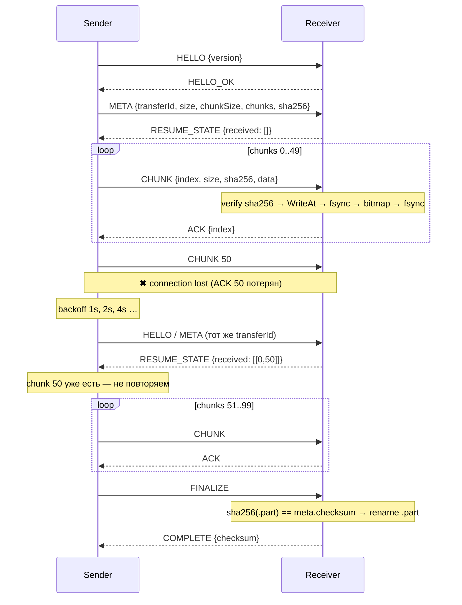

# caravan

Передача файла между двумя компьютерами в локальной сети по частям (chunks) с проверкой
целостности и продолжением после разрыва соединения. Уже подтверждённые части повторно не
отправляются; незавершённая передача переживает перезапуск получателя.

Одно приложение, три команды:

- `caravan receive` — принимать файлы;
- `caravan send` — отправить файл;
- `caravan status` — показать состояние сохранённых передач.

## Сборка и запуск

Нужен Go 1.27+.

```bash
make build            # bin/caravan
make test             # go test ./... (включая сценарий на 100 MB)
make test-race        # go test -race ./...
make lint             # golangci-lint
```

Получатель (ноутбук B, например `192.168.1.15`):

```bash
caravan receive --addr :8080 --dir ./downloads
```

Отправитель (ноутбук A):

```bash
caravan send --file ./archive.zip --addr 192.168.1.15:8080
```

Состояние незавершённых передач на стороне получателя:

```bash
caravan status --dir ./downloads            # все
caravan status --dir ./downloads 4be271a1…  # одна
```

## Флаги

`receive`

| Флаг | По умолчанию | Назначение |
|---|---|---|
| `--addr` | `:8080` | адрес прослушивания |
| `--dir` | `./downloads` | куда класть файлы и состояние |
| `--max-transfers` | `4` | лимит одновременных передач |
| `--max-chunk-size` | `64MB` | максимальный размер chunk, который примет получатель |
| `--read-timeout` | `60s` | закрыть соединение, если от отправителя нет кадра дольше этого |
| `--no-fsync` | выкл. | не делать fsync перед ACK (быстрее, менее надёжно) |

`send`

| Флаг | По умолчанию | Назначение |
|---|---|---|
| `--file` | — | файл (обязательно) |
| `--addr` | — | `host:port` получателя (обязательно) |
| `--chunk-size` | `1MB` | размер части: `256KB`, `1MB`, `4MB` |
| `--max-retries` | `10` | попыток переподключения подряд без прогресса, `0` — без ограничения |
| `--retry-delay` | `1s` | пауза перед первым переподключением, далее удваивается до 30 s |
| `--dial-timeout` | `5s` | таймаут TCP-соединения |
| `--ack-timeout` | `30s` | ожидание ACK и ответов на handshake |
| `--finalize-timeout` | `5m` | ожидание итоговой проверки файла получателем |

Общий флаг `--log-level debug|info|warn|error` (по умолчанию `info`). На уровне `debug`
логируется каждый CHUNK/ACK с индексом и checksum.

Прогресс печатается в stdout одной обновляемой строкой (в терминале) или строкой раз в 2 с
(в файл/пайп): байты, проценты, chunks, скорость, ETA. Логи идут в stderr.

## Как это работает

### Chunks и transfer ID

Отправитель считает SHA-256 файла потоком, не загружая его в память, и выводит
`transferId = sha256(fileSHA256 ‖ fileSize ‖ fileName)[:16]`. Один и тот же файл всегда
получает один и тот же ID, поэтому отправителю не нужно хранить состояние: повторный запуск
`send` после обрыва или перезапуска продолжает ту же передачу. Изменённый файл автоматически
становится новой передачей; если файл изменился в процессе (размер или mtime), отправитель
отказывается продолжать с ошибкой `source file changed`.

Chunk читается через `ReadAt` по индексу; в памяти одновременно один chunk.
Размер chunk фиксируется при создании передачи: если отправитель вернулся с другим
`--chunk-size`, получатель отвечает сохранённым размером и отправитель принимает его.

### Состояние на получателе

```
downloads/
  archive.zip                       # готовый файл
  .caravan/
    4be271a1b2c3d4e5/
      metadata.json                 # Meta + status + updatedAt
      received.bitmap               # бит на chunk
      archive.zip.part              # файл, предварительно размеченный до полного размера
```

Chunk записывается по смещению `index × chunkSize`, затем `fsync` файла, бит в bitmap,
bitmap записывается атомарно (tmp + rename) и тоже `fsync`, и только потом уходит ACK.
Значит ACK означает «данные на диске», и состояние переживает как разрыв сети, так и
`kill -9` получателя. После успешной итоговой проверки `.part` переименовывается в
конечное имя (при коллизии — `archive (1).zip`), bitmap удаляется, а `metadata.json`
остаётся со статусом `completed` и путём к файлу. Если отправитель не дождался `COMPLETE`
и подключился снова, получатель отвечает `RESUME_STATE{status: completed}` и повторный
`FINALIZE` просто подтверждает результат — ничего не пересылается. Если итоговый checksum
не сошёлся, передача получает статус `failed`, `.part` удаляется, и следующая попытка
начинается с нуля. Повторный `send` того же файла после того, как получатель удалил
результат, тоже начинает передачу заново.

Имя файла из сети не используется как путь: берётся только базовое имя, удаляются
управляющие символы и ведущие точки, пустое имя заменяется на transfer ID.

Статусы: `created → transferring → interrupted | completed | failed`
(`interrupted → transferring` при переподключении). При старте получатель сканирует
`.caravan/`, переводит «зависшие» `transferring` в `interrupted` и пишет их в лог.
`caravan status` только читает: пока получатель не перезапущен, убитая передача
показывается как `transferring`.

Повторно пришедший chunk, который уже есть в bitmap, подтверждается ACK без записи.

## Протокол

Собственный протокол поверх TCP. TCP — поток байтов, поэтому каждое сообщение упаковано в
кадр с длиной:

```
uint32 BE  length   = 1 + len(payload)
uint8      type
[]byte     payload
```

Получатель читает ровно `length` байт после заголовка (`io.ReadFull`) и так находит границу
следующего сообщения. Кадр длиннее `--max-chunk-size + 64` отвергается.

Служебные сообщения — JSON, chunk — бинарный заголовок и сырые данные без копирования:

| type | Сообщение | Направление | Payload |
|---|---|---|---|
| 1 | `HELLO` | S → R | `{"version":1}` |
| 2 | `HELLO_OK` | R → S | `{"version":1}` |
| 3 | `META` | S → R | `{transferId, fileName, fileSize, chunkSize, chunks, checksum}` |
| 4 | `RESUME_STATE` | R → S | `{transferId, status, chunkSize, chunks, received: [[0,37],[40,45]], receivedChunks}` |
| 5 | `CHUNK` | S → R | `u64 index · u32 size · [32]byte sha256 · data` |
| 6 | `ACK` | R → S | `{"index": 42}` |
| 7 | `FINALIZE` | S → R | `{"transferId"}` |
| 8 | `COMPLETE` | R → S | `{transferId, checksum}` |
| 9 | `ERROR` | R → S | `{code, message, index?}` |

Коды `ERROR`:

| code | Когда | Реакция отправителя |
|---|---|---|
| `bad_version` | версия протокола не совпала | фатально |
| `busy` | лимит одновременных передач | переподключение с backoff |
| `invalid_meta` | chunk вне `[4 KB, max]`, число chunks не сходится, плохое имя | фатально |
| `meta_mismatch` | тот же ID, но другой размер/checksum | фатально |
| `bad_checksum` | SHA-256 chunk или его длина не совпали | повтор этого chunk (до 3 раз) |
| `out_of_range` | индекс ≥ chunks | фатально |
| `incomplete` | FINALIZE при неполном bitmap | — |
| `checksum_mismatch` | итоговый SHA-256 не совпал | фатально, передача `failed` |
| `io_error` | диск: нет места, прав и т.п. | переподключение с backoff |

Поток одного соединения и переподключение:



Chunks передаются последовательно: следующий уходит после ACK предыдущего. Для LAN с
chunk 1 MB этого достаточно, а протокол остаётся простым.

### Таймауты

| Операция | Значение | Почему |
|---|---|---|
| TCP connect | 5 s | в LAN соединение устанавливается за миллисекунды; дольше — хост недоступен |
| запись кадра | 30 s | chunk до 64 MB по медленному Wi-Fi |
| ожидание ACK / handshake | 30 s | получатель успевает проверить SHA-256, записать и сделать `fsync` даже на HDD |
| ожидание COMPLETE | 5 min | получатель хэширует весь файл (несколько GB на ~1 GB/s) |
| простой соединения у получателя | 60 s | отправитель молчит дольше минуты только если соединение умерло |
| backoff переподключения | 1 s → 30 s, 10 попыток | не долбить сеть, но пережить короткое отключение Wi-Fi |
| graceful shutdown | 10 s | сессиям хватает, чтобы дописать текущий chunk и сохранить статус |

Все значения настраиваются флагами.

## Завершение

`Ctrl+C` / `SIGTERM`: получатель перестаёт принимать соединения, закрывает активные,
каждая сессия дописывает текущий chunk, сохраняет статус `interrupted` и закрывает файлы.
Отправитель закрывает соединение и выходит; повторный `send` продолжит с места разрыва.

## Структура

```
cmd/caravan         точка входа
internal/cli        cobra-команды, прогресс, парсинг размеров
internal/protocol   кадры, сообщения, CHUNK
internal/transfer   Meta, transfer ID, bitmap, SHA-256
internal/sender     клиент: хэш → META → chunks → FINALIZE, reconnect с backoff
internal/receiver   сервер, сессия, хранилище состояния на диске
tests               e2e-сценарии с TCP-proxy, который рвёт и портит поток
```

## Ограничения

- Шифрования и авторизации нет: только доверенная локальная сеть.
- Chunks идут последовательно, параллельной отправки нет.
- Осиротевшие `.part` (отправитель изменил файл и начал новую передачу) и записи о
  завершённых передачах в `.caravan/` не удаляются автоматически; их видно в `caravan status`.
